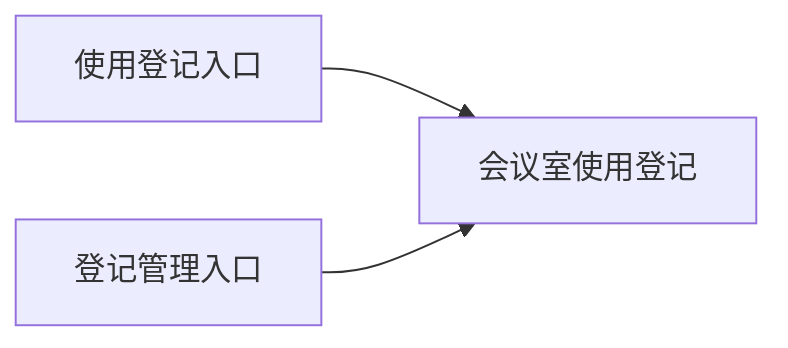

# 示例说明

以下是假设需求的表达示例，不是当前用户需求。示例需求已明确：搭建会议室登记系统；登记会议室名称、使用日期、开始时间、结束时间和登记人；无需审批、不做仪表盘；普通用户仅新增及查看本人登记，管理员可查看和编辑全部登记；暂不做时间冲突自动校验。

以下采用轻量结构；以下只演示响应 construction_plan_markdown 的正文，不含本说明；实际外层响应遵守 call-contract.md 的 JSON 契约。示例权限是该示例的明确输入，不能作为其他系统的默认权限。

---

# 会议室登记系统·业务系统建设方案

## 1. 会议室登记系统

用于记录会议室使用安排，覆盖登记与查询，服务普通用户和管理员。采用轻量结构，省略第 4、5、7 章：无需审批、无仪表盘及可选自动化要求。

### 1.1 已确认

| # | 事项 | 内容 | 来源 |
| --- | --- | --- | --- |
| 1 | 系统名称 | 会议室登记系统 | 示例需求 |
| 2 | 本期范围 | 使用登记、本人查询、管理员查询与编辑 | 示例需求 |
| 3 | 明确不做 | 审批、仪表盘、时间冲突自动校验 | 示例需求 |
| 4 | 权限 | 普通用户新增及查看本人登记；管理员查看和编辑全部登记 | 示例需求 |

### 1.2 AI 补全

| # | 事项 | 补全内容 | 理由 |
| --- | --- | --- | --- |
| 1 | 应用对象 | 使用登记由一张登记表承载 | 业务范围单一，无须额外拆表 |
| 2 | 导航 | 使用登记前台入口、登记管理后台入口 | 分别承载普通使用和管理操作 |
| 3 | 字段属性 | 名称、日期、时间、登记人必填；登记人默认当前用户 | 支撑有效登记与本人范围识别，属本次设计补全 |

## 2. 应用结构与导航

### 2.1 业务域与对象关系

| 业务域 | 域内对象 | 说明 |
| --- | --- | --- |
| 使用登记 | 会议室使用登记 | 记录会议室与使用时段 |

### 2.2 应用分组

```text
会议室登记系统
├─ 使用登记 → 会议室使用登记（前台）
└─ 登记管理 → 会议室使用登记（后台）
```

### 2.3 对象清单

| 名称 | 类型 | 用途 |
| --- | --- | --- |
| 会议室使用登记 | 表单 | 记录会议室使用安排 |

### 2.4 模块关系



图中两入口是同一对象的入口，不是额外应用。

## 3. 表单设计

### 会议室使用登记

| 字段 | 类型 | 必填 | 默认值 | 选项 / 公式 | 说明 |
| --- | --- | --- | --- | --- | --- |
| 会议室名称 | 单行文本 | 是 | 无 | 不适用 | 使用的会议室 |
| 使用日期 | 日期 | 是 | 无 | 不适用 | 精度到日 |
| 开始时间 | 日期时间 | 是 | 无 | 不适用 | 精度到分钟；应与使用日期一致 |
| 结束时间 | 日期时间 | 是 | 无 | 不适用 | 精度到分钟；应与使用日期一致且晚于开始时间 |
| 登记人 | 联系人 | 是 | 当前用户 | 不适用 | 对应用户身份 |

开始、结束时间采用日期时间控件是本次设计选型，不表示用户指定了控件；日期一致及先后关系须在实施中核对可用校验方式，不承诺模板未定义的校验接口。

## 6. 权限设计

### 6.1 菜单权限

| 角色 | 可见入口 | 不可见入口 |
| --- | --- | --- |
| 普通用户 | 使用登记 | 登记管理 |
| 管理员 | 登记管理 | 使用登记，未提出代登记需求 |

管理员前台入口限制为设计建议，需在业务系统建设方案确认时确认，不作为用户授权事实。

### 6.2 应用权限

| 角色 | 对象 | 数据范围 | 字段权限 | 功能权限 |
| --- | --- | --- | --- | --- |
| 普通用户 | 会议室使用登记 | 仅本人 | 新增时填写登记信息；查看本人字段 | 新增、查看；不增加未授权功能 |
| 管理员 | 会议室使用登记 | 全部 | 查看及编辑登记字段 | 查看、编辑；不增加删除与导出 |

## 8. 实施与交接

### 8.1 自动搭建范围

| 对象 | 是否自动搭建 | 说明 |
| --- | --- | --- |
| 表单与字段 | 部分 | 自动创建协议支持的字段，必填与默认值等人工补齐 |
| 权限与页面 | 否 | 依本方案人工配置入口与数据范围，核验后再启用 |

### 8.2 实施顺序

1. 创建应用包及两个菜单入口。
2. 创建会议室使用登记及字段。
3. 人工配置前后台页面和已确认角色权限，核对日期时间字段的校验方式；关键权限和时间校验未落实前不启用。
4. 挂接入口并验证普通用户只能查看本人登记。

## 9. 风险与待确认

- **时间重叠**：本期不做自动冲突校验，可能出现重复使用安排；建议管理员核对，负责人为业务管理员。
- **管理员前台入口**：示例需求未指定是否允许代登记，当前入口建议需确认，不直接扩展权限；负责人为需求负责人。
- **时间校验能力**：模板未提供校验实现细节，实施前核对可用配置；负责人为实施人员。