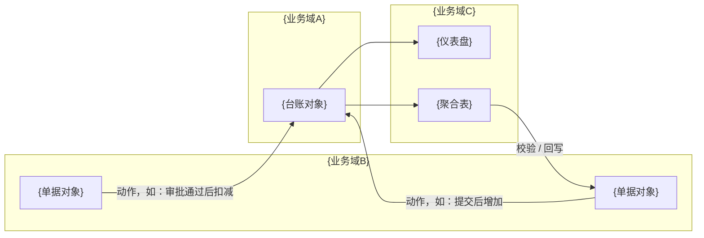

## 1. {系统名称}
{系统名称}用于{解决什么问题}，覆盖{业务环节}，服务{主要角色}。

### 1.1 已确认

| # | 事项 | 内容 | 来源 |
| --- | --- | --- | --- |
| 1 | {系统名称} | {名称} | 用户原文 / 需求文档 |
| 2 | {业务范围} | {范围} | 用户原文 / 需求文档 |
| 3 | {本期应用} | {应用数量与类型} | 用户原文 / 需求文档 |
| 4 | {明确不做} | {排除项} | 用户原文 / 需求文档 |

### 1.2 AI 补全

| #   | 事项     | 补全内容  | 理由       |
| --- | ------ | ----- | -------- |
| 1   | {系统名称} | {补全值} | {为什么这样补} |
| 2   | {状态取值} | {补全值} | {为什么这样补} |

---

## 2. 应用结构与导航

### 2.1 业务域与对象关系

| 业务域   | 域内对象   | 说明          |
| ----- | ------ | ----------- |
| {域名称} | {对象名称} | {这个域解决什么问题} |

### 2.2 应用分组

```text
{应用包名称}
├─ {分组1}
│  ├─ {入口1} → {对象名称}
│  └─ {入口2} → {对象名称}
└─ {分组2}
   └─ {入口3} → {对象名称}
```

### 2.3 对象清单

| 名称     | 类型  | 用途         |
| ------ | --- | ---------- |
| {表单名}  | 表单  | {回答什么业务问题} |
| {仪表盘名} | 仪表盘 | {给谁看什么}    |

### 2.4 模块关系


---

## 3. 表单设计

###  {表单名称}

| 字段    | 类型      | 必填    | 默认值   | 选项 / 公式     | 说明        |
| ----- | ------- | ----- | ----- | ----------- | --------- |
| {字段名} | {白名单类型} | 是 / 否 | {默认值} | {选项值，或计算公式} | {业务含义与约束} |
###  {表单名称}
...

---

## 4. 流程设计
### {流程名称}

{一句话概括审批流}
对应表单：{表单名称}

| 节点      | 审批人     | 字段权限   |
| ------- | ------- | ------ |
| 1 发起    | {审批人名称} | 全部字段   |
| 2 {节点名} | {审批人名称} | 全部字段   |
| 3 {节点名} | {审批人名称} | {字段范围} |

分支规则："条件成立走哪个节点、条件不成立走哪个节点"

### {流程名称}
...

---

## 5. 仪表盘设计

| 仪表盘名称 | 组件                         | 数据源    | 维度 / 指标       | 说明   |
| ----- | -------------------------- | ------ | ------------- | ---- |
| {名称}  | 指标卡 / 柱状图 / 饼图 / 折线图 / 明细表 | {表单名称} | 维度：{X}；指标：{Y} | {口径} |

---

## 6. 权限设计

### 6.1 菜单权限

| 角色     | 可见入口   | 不可见入口  |
| ------ | ------ | ------ |
| {角色名称} | {分组名称} | {分组名称} |

### 6.2 应用权限

| 角色     | 对象      | 数据范围           | 字段权限        | 功能权限                   |
| ------ | ------- | -------------- | ----------- | ---------------------- |
| {角色名称} |  {对象名称} | 全部 / 本部门 / 仅本人 | {敏感字段只读或隐藏} | 新增 / 编辑 / 删除 / 导入 / 导出 |

---

## 7. 可选能力（按需启用）

### 聚合表

| 聚合表  | 数据源与过滤        | 维度     | 指标与口径       | 提交限制       |
| ---- | ------------- | ------ | ----------- | ---------- |
| {名称} | {表单名称 + 过滤条件} | {维度字段} | {指标 = 计算方式} | {上限值与提示文案} |

### 业务流
| 触发条件                      | 源表     | 目标表    | 写入字段与取值             |
| ------------------------- | ------ | ------ | ------------------- |
| {审批通过 / 新增 / 修改为某状态 / 定时} | {对象名称} | {对象名称} | {字段 = 固定值，或 = 源表字段} |

### 数据工厂

| 数据源 | 处理步骤 | 输出字段 | 执行频率 | 结果存储 |
| --- | --- | --- | --- | --- |
| {表单 / 审批} | 取数 → 过滤 → 分组 → 计算 → 输出 | {字段名与口径} | 实时 / 定时 | 写回 {表名} / 仅图表可见 |

### 报告引擎/报表引擎
{一句话概括报告/报表的作用}
数据源包含：{表单名称}


---

## 8. 实施与交接

### 8.1 自动搭建范围

| 对象               | 是否自动搭建 | 说明   |
| ---------------- | ------ | ---- |
| 表单与字段            | 是      | {说明} |
| 审批流              | 是      | {说明} |
| 权限与页面            | 是      | {说明} |
| 仪表盘              | 是      | {说明} |
| 聚合表 / 数据工厂 / 业务流 | 否      | {说明} |

### 8.2 实施顺序

1. 创建应用包与分组，建立菜单入口
2. 创建表单与字段，配置关联关系与计算公式
3. 对流程表单创建审批流并启用
4. 配置权限组、页面与视图
5. 配置业务流并调试启用
6. 创建仪表盘并设为首页
7. 配置可选能力（聚合表 / 数据工厂 / 推送提醒）
8. 按第 2 章结构打包应用包，配置菜单权限

---

## 9. 风险与待确认
- **事项名称**：影响、建议、负责人。
- **事项名称**：...
